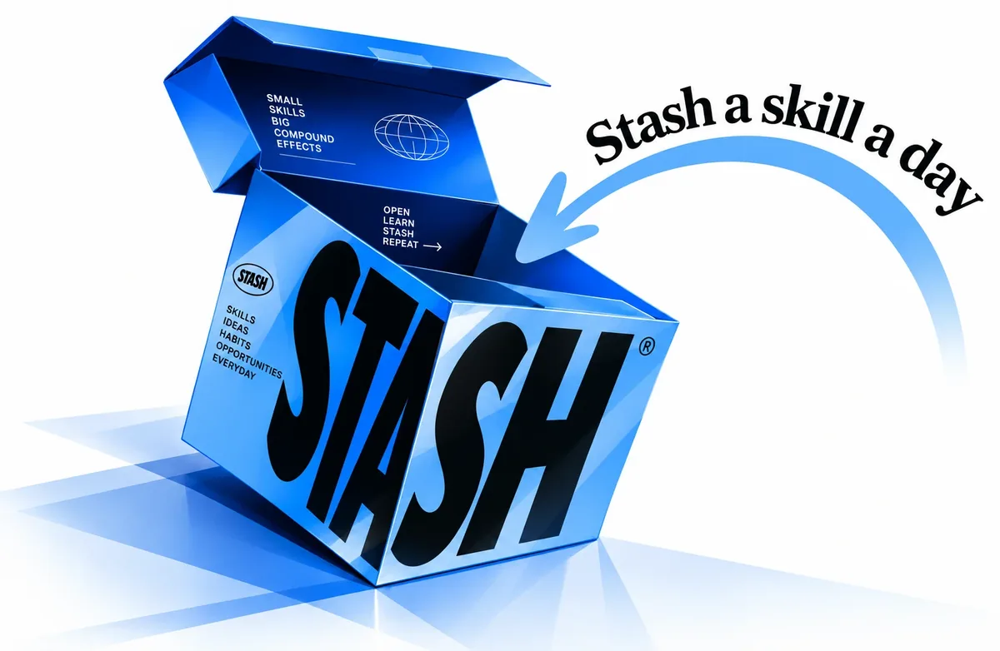

# Stash

**Stash a skill a day.**



Mobile learning app prototype: short lessons, PDF-to-podcast, and a career view that compares a target role with evidence the learner has recorded.

This is a design prototype with real local behaviour. It is not a production app. Everything that needs a server is labelled "Demo mode" or "Not connected" on screen.

## Run it

No build step and no dependencies to install.

```bash
python3 ~/Downloads/Projects/stash/tools/serve.py 4180 ~/Downloads/Projects/stash
```

Open http://localhost:4180. The page shows only the phone: framed on a wide window, full screen on a phone. Add `?fi=midfi`, `?fi=wire` or `?fi=lofi` to the URL for the other fidelities. Sample data loads from Profile > Preferences > Load showcase data.

A single self-contained file, `deliverables/Stash-Mobile-Prototype.html`, opens by double-click with no server. Rebuild it with `tools/build-single.sh` (uses esbuild through npx).

Rebuild the three PDFs (needs Google Chrome and Python with PyMuPDF):

```bash
tools/build-pdfs.sh
```

Rebuild the editable draw.io version of the lo-fi boards:

```bash
tools/build-drawio.sh
```

## Deploy

Live at https://stash-mobile-flax.vercel.app. The Vercel project `stash-mobile` is connected to this repo: every push to `main` deploys to production. `.vercelignore` keeps build tools and board files off the site.

The PDFs, `.drawio` file and single-file HTML in `deliverables/` are generated by the scripts in `tools/` and are not committed.

## Where things are

| Path | What |
|---|---|
| `index.html` | App entry |
| `board.html` | The workshop boards the PDFs are printed from |
| `styles/tokens.css` | Every colour, radius and type size, for all three fidelities |
| `styles/app.css` | Components, scoped to `.app` |
| `src/data.js` | Sample content and the JSDoc data models. Sample data only |
| `src/store.js` | User state in `localStorage`, plus selectors (evidence, coverage, gaps, plan) |
| `src/services.js` | Integration boundary: PDF extraction, script builder, job key, file output |
| `src/ui.js` | Pure HTML-string components |
| `src/s-*.js` | Screens by area. Each is `render(ctx)` returning `{top, body, foot}` |
| `src/registry.js` | Screen list, board order, the phone frame |
| `src/app.js` | Router, actions, audio engine, conversion job runner |
| `deliverables/` | The three PDFs |
| `tools/fixtures/` | Small files used to test upload validation |

Screens are pure functions of state, so the live app and the PDF boards render the same code.

## What really works

- Navigation across 52 screens, five tabs, hash routes, in-app and browser back.
- State persists across reloads in `localStorage`; large files (audio, attachments) in IndexedDB. Passwords are never stored.
- Onboarding with a "just curious" path, résumé reading (PDF, on the device, skills suggested with the sentence they came from, nothing added until confirmed).
- Learning: 8 sample courses (5 on Trust & Safety and data), reader with saved position, takeaway split into "what I learned" and "how I'll use it", quiz with retry.
- **Proof of skill**, four kinds kept separate:
  - Proof added: project, certificate or work sample, with an optional PDF/image attachment kept on the device.
  - Passed skill check: 4-question recall checks for SQL, Python, detection models, T&S policy and communication; pass with 3. Labelled as not a certification.
  - Completed learning, and self-reported.
- **Live jobs** from MyCareersFuture through `api/jobs.js` (public API, no key, cached 30 min). If the exact target title finds nothing, the search widens step by step and says so. Listed skills are mapped to Stash skills; the original listing opens on MyCareersFuture. Four labelled sample listings stay as a fallback.
- **PDF to podcast with real audio.** Text is extracted on the device with pdf.js; the script is a template (no LLM, by decision); voices are rendered on the device by Kokoro-82M through kokoro-js in a Web Worker (Apache-2.0). High quality (default) uses the full-precision model, about 330 MB downloaded once, which on a laptop renders about as fast as real time; Standard uses the 90 MB 8-bit model. Page numbers, classification labels such as "SMU Classification: Restricted" and lines repeated on most pages are removed before the script is written, and bullet points become separate sentences. Six voices, two-host or solo. Real progress per line, cancel, failure with retry or "use the device voice instead", resume after reload. The result is a WAV file with exact line timings, played through an audio element with seek, speed, sleep timer, queue and lock-screen controls, and downloadable.
- **Sync across devices** without a password: a random 16-character code. State is encrypted on the device (AES-GCM, key from PBKDF2) and stored as ciphertext in a private Vercel Blob store through `api/sync.js`. Turning sync off deletes the stored copy. Audio and attachments do not sync.
- Study plan, month calendar and `.ics` export; import and export (Markdown, JSON, CSV).
- Accessibility settings: text size, reduce transparency, reduce motion.
- Usability testing: with `?dev=1`, Preferences can record a session log (screens and taps with times, on the device) and download it. See `docs/usability-test.md`.

## What is still simulated or missing

| Area | Today | To go further |
|---|---|---|
| Accounts | Demo sign-in; sync code instead of a password | Real accounts with recovery |
| Script writing | Template quoting the PDF | Optional LLM step (deliberately not built) |
| OCR | Not connected | OCR provider |
| Voice speed | About real time on a laptop with High quality; slower on phones | WebGPU when stable, or server rendering for slow phones |
| Jobs | One source | More sources, saved searches |
| DOCX résumés | Attached, not read | Server parser |

## Server side

`api/jobs.js` and `api/sync.js` are Vercel functions. Sync needs `BLOB_READ_WRITE_TOKEN`, which Vercel sets when the `stash-sync` Blob store is linked to the project. `vercel.json` sets cross-origin isolation headers so the voice model can use several CPU threads. For local work, `tools/serve.py` mirrors both functions (sync kept in memory) and sends the same headers.

## Assumptions worth knowing

- The original single-file prototype was not available, so this was rebuilt from the three PDFs and the phase 1 paper sketch.
- Audience (busy learners, people preparing for a role, commuters) is a hypothesis, not research.
- Glass is used where something scrolls behind it: tab bar, mini-player, action footer, sheets. Cards are translucent without blur.
- Palette (Oct 2026): vivid blue #0088FF, pastel blue #8FBBE8, light grey #C3C3C3, dark grey cyan #030404, white. Two steps are derived for contrast: links and blue text use #0068C4 (5.6:1 on white), and input borders use #878C8C (3.4:1). Text on vivid-blue buttons is #030404 (5.8:1), because white on #0088FF is only 3.5:1.
- 52 screens instead of 40: the extra ones are states the old set only described in notes, plus skill checks and sync.

## Persona

Showcase data uses Andi Pasca Hasanuddin: Rapid Response Analyst at TikTok, Singapore, studying the SMU MITB AI track, moving toward data science in Trust & Safety. Name, role, skills and studies come from his LinkedIn profile export. Course progress, takeaways and the evidence entry marked "Sample entry" are demo activity, not his real work. The target role "Trust & Safety Data Scientist" and its listing are samples chosen to match the direction in his profile summary.
